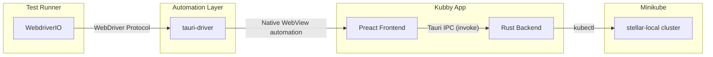

# E2E Tests with WebdriverIO + tauri-driver

## Architecture




## 1. Dependencies and Scaffolding

Install WebdriverIO with Mocha and Tauri service:

- `@wdio/cli`, `@wdio/local-runner`, `@wdio/mocha-framework`, `@wdio/spec-reporter`, `webdriverio`, `expect-webdriverio`, `ts-node`
- `tauri-driver` via `cargo install tauri-driver`

### File structure

```
e2e/
  wdio.conf.ts              # WebdriverIO config
  tsconfig.json              # TS config for e2e
  helpers/
    setup.ts                 # beforeSuite: ensure context/namespace, helpers
    selectors.ts             # Centralized selector functions (by role, text, aria-label)
    navigation.ts            # Helpers: navigateToDashboard, navigateToResourceList, etc.
    keyboard.ts              # Helpers: pressKey, arrowDown(n), etc.
  specs/
    dashboard.spec.ts        # Dashboard tests (1a-1c)
    resource-list.spec.ts    # ResourceList tests (2a-2o)
    describe.spec.ts         # Describe/Detail tests (3a-3f)
    logs.spec.ts             # Log viewer tests (4a-4c)
```

### Scripts in [package.json](package.json)

```json
"test:e2e": "wdio run e2e/wdio.conf.ts",
"test:e2e:setup": "./scripts/local-k8s/setup.sh"
```

### Makefile targets

```makefile
test-e2e-setup:
	./scripts/local-k8s/setup.sh

test-e2e: build
	KUBECONFIG=... KUBBY_CONFIG=... tauri-driver & wdio run e2e/wdio.conf.ts; kill %1
```

## 2. wdio.conf.ts Configuration

Key config:

- **capabilities**: `{ 'tauri:options': { application: './src-tauri/target/debug/kubby' } }`
- **port**: 4444 (tauri-driver default)
- **framework**: mocha
- **reporter**: spec
- **env**: `KUBECONFIG` and `KUBBY_CONFIG` pointed at `scripts/local-k8s/config/`
- **mochaOpts.timeout**: 30000 (k8s operations are slow)

The app binary is built with `pnpm tauri build --debug` before tests run.

## 3. Accessibility Roles to Add (Component Changes)

The codebase currently has very few `role` attributes. To enable robust selectors per the "use only text or role" requirement, the following roles need to be added:


| Component                   | File                                                                                                         | Role to add                                                                                                                  |
| --------------------------- | ------------------------------------------------------------------------------------------------------------ | ---------------------------------------------------------------------------------------------------------------------------- |
| DashboardTable              | [src/pages/Dashboard/DashboardTable.tsx](src/pages/Dashboard/DashboardTable.tsx)                             | `role="grid"` on `<table>`, `role="row"` on `<tr>`, `role="gridcell"` on cell `<td>`, `role="columnheader"` on `<th>`        |
| ResourceList table          | [src/pages/ResourceList/ResourceList.tsx](src/pages/ResourceList/ResourceList.tsx)                           | `role="grid"` on `<table>`, `role="row"` on `<tr>`, `role="gridcell"` on `<td>`, `role="columnheader"` on `<th>`             |
| Combobox                    | [src/components/Combobox/Combobox.tsx](src/components/Combobox/Combobox.tsx)                                 | Already uses downshift which provides ARIA. Add `aria-label` with the `label` prop value to the wrapper for easier selection |
| ShortcutsBar buttons        | [src/components/ShortcutsBar/ShortcutsBar.tsx](src/components/ShortcutsBar/ShortcutsBar.tsx)                 | `role="toolbar"` on the bar                                                                                                  |
| Alert                       | [src/components/Alert/Alert.tsx](src/components/Alert/Alert.tsx)                                             | `role="alert"` on the wrapper                                                                                                |
| FilterInput                 | [src/components/FilterInput/FilterInput.tsx](src/components/FilterInput/FilterInput.tsx)                     | `role="searchbox"` on `<input>`                                                                                              |
| HighlightInput              | [src/components/HighlightInput/HighlightInput.tsx](src/components/HighlightInput/HighlightInput.tsx)         | `role="searchbox"` on `<input>`                                                                                              |
| Breadcrumb items            | [src/components/Breadcrumb/Breadcrumb.tsx](src/components/Breadcrumb/Breadcrumb.tsx)                         | Already has `aria-label="Navigation breadcrumb"` on `<nav>`. Add `role="link"` on each breadcrumb button for clarity         |
| ResourceDetail view toggle  | [src/pages/ResourceDetail/ResourceDetail.tsx](src/pages/ResourceDetail/ResourceDetail.tsx)                   | `role="tablist"` on the view-mode button group (Tree/Yaml/Json), `role="tab"` + `aria-selected` on each button               |
| ScaleModal replicas input   | [src/components/ScaleModal/ScaleModal.tsx](src/components/ScaleModal/ScaleModal.tsx)                         | `aria-label="Replicas"` on the input                                                                                         |
| PortForwardModal            | [src/components/PortForwardModal/PortForwardModal.tsx](src/components/PortForwardModal/PortForwardModal.tsx) | `role="table"` on the existing forwards table                                                                                |
| ConfirmModal force checkbox | [src/components/ConfirmModal/ConfirmModal.tsx](src/components/ConfirmModal/ConfirmModal.tsx)                 | `aria-label="Force delete"` on the force checkbox if present                                                                 |


**Minimal test-id usage**: Only add `data-testid` for the resource list selected row indicator (`data-testid="selected-row"`) since there's no semantic way to identify "which row is focused" otherwise.

## 4. Test Helper Functions

### `helpers/navigation.ts`

Reusable functions so each test is self-contained:

- `navigateToDashboard()` - press Escape repeatedly until Dashboard breadcrumb is visible
- `navigateToResourceList(context, namespace)` - from Dashboard, click the cell matching context+namespace
- `ensureContext(context)` - open Context combobox (Alt+C), select the given context
- `ensureNamespace(namespace)` - open Namespace combobox (Alt+N), select
- `ensureResourceType(type)` - open Resource combobox (Alt+R), select
- `selectRowByText(text)` - arrow-key or filter to select a row containing `text`
- `waitForResourcesLoaded()` - wait until no "Loading..." indicator and item count footer is visible

### `helpers/selectors.ts`

Text and role-based selectors only:

- `byRole(role)`, `byRoleAndName(role, name)`, `byText(text)`, `byAriaLabel(label)`
- `modalTitle()`, `modalButton(text)`, `breadcrumb()`
- `comboboxByLabel(label)`, `buttonByLabel(label)`

### `helpers/keyboard.ts`

- `pressKey(key)`, `pressKeys(keys)` (e.g., `['ArrowDown', 'ArrowDown', 'Enter']`)
- `typeText(text)` for filter
- Platform-aware modifier keys

## 5. Test Specifications

### 5.1 `dashboard.spec.ts` — Dashboard

Each test starts from Dashboard (navigate back if needed).

**a) Navigate in group with keyboard**

- Verify Dashboard is shown (text "Dashboard" in breadcrumb)
- Press ArrowDown, ArrowRight to move between cells
- Verify focus moves (check `document.activeElement` data attributes)

**b) Navigate between groups**

- Press Tab to move to next group
- Verify focus is in a different group section (different `data-col` range)
- Press Shift+Tab to go back

**c) Filter**

- Type a namespace fragment (e.g., "stellar-domains")
- Verify only matching namespaces are visible
- Verify non-matching namespaces are hidden
- Press Escape to clear filter
- Verify all namespaces return

### 5.2 `resource-list.spec.ts` — ResourceList

Each test navigates to ResourceList with a known context (`live-kappa-nebula237-live-kappa`) and namespace (`ns-team-stellar-domains`).

**a) Navigate with keyboard in items**

- Wait for resources loaded
- Press ArrowDown 3 times, verify selection moves
- Press ArrowUp, verify selection moves back
- Press Home/End

**b) Refresh**

- Note current item count
- Press Ctrl+R
- Wait for refresh indicator then items reappear
- Verify items are present

**c) Switch context**

- Press Alt+C to open context combobox
- Type to filter, select a different context
- Verify resources reload (wait for loading, then items)

**d) Switch namespace**

- Press Alt+N, select `ns-team-stellar-operations`
- Verify resources reload with new namespace

**e) Switch resource type to httpproxies and back**

- Press Alt+R, type "http", select "httpproxies"
- Verify resources list shows httpproxy items
- Press Alt+R, type "deploy", select "deployments"
- Verify back to deployments

**f) Drill down: deployments -> pods -> containers -> back**

- Select a deployment, press Enter (drill to pods)
- Verify breadcrumb shows pods filtered by app label
- Select a pod, press Enter (drill to containers)
- Verify breadcrumb shows containers
- Press Escape (back to pods)
- Press Escape (back to deployments)

**g) Rolling restart**

- Select a deployment (e.g., `domains-api-service`)
- Note current pod names by drilling into pods (Enter), reading names, then going back (Escape)
- Press R to open Rolling Restart modal
- Verify modal title "Rolling Restart" is visible
- Press Enter to confirm
- Verify modal closes (no error alert)
- **Verify effect**: Drill into pods (Enter), wait for pods to start cycling — use `waitUntil` to poll until at least one pod name differs from the original set (new pods get new random suffixes as k8s recreates them). Alternatively, go to Describe (D) and verify `kubectl.kubernetes.io/restartedAt` annotation exists in the tree.
- Go back to deployments (Escape)

**h) Scale: increase replicas by 1**

- Select deployment (`domains-api-service`, currently 3 replicas), press S
- Verify modal title "Scale Deployment"
- Read current replicas value from input (should be 3)
- Increment by 1 (clear input, type "4")
- Press Enter to scale
- Verify modal closes
- **Verify effect**: Press Ctrl+R to refresh the resource list. Use `waitUntil` to poll until the READY column for `domains-api-service` shows `4/4` (new pod needs time to become ready). Timeout generously (60s) since pod scheduling takes time.

**i) Jump to events, back**

- Select deployment, press J to open Jump dropdown
- Select "events" from the dropdown menu
- Verify breadcrumb shows events
- Press Escape to go back to deployments

**j) Delete pod with force**

- Ensure resource type = pods
- Record the name of the first pod (read text from the selected row)
- Press Delete
- Verify "Delete Resource" modal appears
- Check the force checkbox
- Press Enter to confirm
- Verify modal closes
- **Verify effect**: Press Ctrl+R to refresh. Use `waitUntil` to poll until the deleted pod name is no longer in the list (it gets replaced by a new pod with a different name since the deployment recreates it). The total item count in the footer should remain the same (deployment maintains desired replicas).

**k) Port forward: add and stop**

- Ensure resource type = pods, drill to containers
- Select a container, press F
- Verify "Port Forward" modal appears
- Verify first port row is pre-selected (checkbox is checked)
- Note the local port value shown
- Press Enter ("Add & Close")
- **Verify effect (add)**: Re-open port forward modal (F). Verify "Existing Port Forwards" section appears with a table showing the container name, target port, and local port matching what was configured. Verify a "Stop" button is present.
- Click "Stop All"
- **Verify effect (stop)**: Verify "Existing Port Forwards" section disappears. Verify the port reappears in the "Add Port Forwards" section with a checkbox.
- Close modal (Escape)

**l) Open shell, close**

- Ensure resource type = pods, drill to containers
- Select a container, press S (Shell)
- This opens a terminal window externally; verify no crash/error
- (Cannot fully test external terminal from WebDriver -- verify no error alert)

**m) Open agent, close**

- Navigate to deployments, select a deployment
- Press A (Agent)
- Verify no error (opens external tool)

**n) Open edit, close**

- Select a deployment, press E
- Verify "Editing" chip appears briefly (or no error)
- (External editor -- verify no error alert)

**o) Go back to dashboard**

- Press Escape repeatedly or click "Dashboard" breadcrumb
- Verify Dashboard is shown

### 5.3 `describe.spec.ts` — Describe / Detail

Each test navigates to a deployment describe view.

**a) Open describe**

- Navigate to deployments, select `domains-api-service`, press D
- Verify resource name `domains-api-service` is shown
- Verify Tree view is displayed by default

**b) Filter in describe**

- Press `/`, type "replicas"
- Verify matching text is highlighted (`data-highlight-match="true"`)
- Verify match count indicator shows matches
- Press Escape to clear

**c) View YAML**

- Press Y
- Verify YAML code view is rendered (look for `apiVersion` text)

**d) View JSON**

- Press J
- Verify JSON code view is rendered

**e) Copy**

- Switch to YAML (press Y)
- Press C
- Verify no errors (clipboard write; can check via Tauri clipboard plugin if accessible)

**f) Open edit, close**

- Press E
- Verify no error alert appears

**g) Secrets decode**

- Navigate back to Dashboard, then to ResourceList
- Switch resource type to "secrets"
- Select a secret, press D (describe)
- Verify `[N chars]` hidden markers in tree
- Press X (decode)
- Verify decoded values appear (the text changes from `[N chars]` to actual decoded content)

### 5.4 `logs.spec.ts` — LogViewer

Each test navigates to pod logs.

**a) Open logs**

- Navigate to pods, select a pod, press L
- Verify log viewer shows (text "logs" in resource type)
- Wait for streaming indicator to show "Streaming"
- Verify log lines appear

**b) Filter by "sess"**

- Press `/`, type "sess"
- Verify only matching log lines are visible
- Verify line count changes (e.g., "X / Y lines")

**c) Copy**

- Press C
- Verify no errors

## 6. Execution Strategy -- Avoiding Flakiness

- **Each test is self-contained**: Every `it()` block starts by navigating to the required page/state using helper functions (`navigateToDashboard()`, then `navigateToResourceList(...)`, then `ensureResourceType(...)`, etc.)
- **No inter-test dependencies**: Tests do not rely on state from previous tests. If a test changes data (scale, delete), the next test navigates fresh.
- **Explicit waits**: Use `waitUntil` with polling for resource loading, modal appearance, and breadcrumb changes. Never use fixed `sleep()`.
- **Effect verification via polling**: Mutating actions (rolling restart, scale, delete) need time for k8s to reconcile. Use `waitUntil` with generous timeouts (up to 60s for scale, 30s for delete/restart) and poll by refreshing the resource list (Ctrl+R) and checking the expected state.
- **Known data from minikube**: Tests assert against deployments created by `setup.sh` (e.g., `domains-api-service` with 3 replicas in `ns-team-stellar-domains`). The minikube setup is deterministic.
- **Deleted pod recovery**: The delete test targets a pod (which k8s will recreate via the deployment), so subsequent tests are unaffected. We verify the old pod name disappears and total count stays stable.
- **Scale test cleanup**: After scale test increases replicas from 3 to 4, we verify the READY column shows 4/4. Subsequent tests don't depend on exact replica count.
- **Rolling restart verification**: We compare pod name sets before/after to confirm new pods replaced old ones.
- **Mocha `--retries 1`**: Allow a single retry for transient k8s timing issues.
- `**before` hook per spec file**: Each spec's `before` ensures the app is in a known state (Dashboard visible, correct context).

