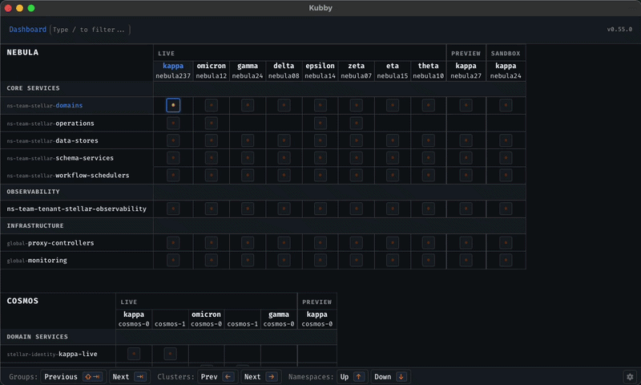

# Kubby


A fast, keyboard-driven desktop app for managing Kubernetes clusters. 
Inspired by [k9s](https://k9scli.io/) with a richer GUI for resource details, logs, actions 
and multi-cluster management.

## Features

- **Fast & Native** - Native performance with view caching and instant startup
- **Keyboard-First** - Comprehensive shortcuts; mouse optional
- **Multi-Cluster** - Dashboard with 2D matrix of clusters and namespaces, quick switching
- **Real-time Updates**: Watch resources update live as changes occur in your cluster
- **Live Logs** - Real-time streaming with syntax highlighting and filtering
- **Actions** - Scale, rolling restart, port-forward, shell, edit, delete, run configurable commands
- **AI Assistant** - Launch Cursor, Claude Code, Augment, or Codex with pre-configured context



[Tour Screenshots](docs/tour.md)

## Installation

### Prerequisites

- macOS 11 (Big Sur) or later
- `kubectl` installed and configured
- At least one cluster in your kubeconfig file

### Credential Plugins

If your cluster uses exec-based auth, ensure the plugin is in your `PATH`:
- Azure AKS: `kubelogin`
- AWS EKS: `aws-iam-authenticator` or `aws`
- GCP GKE: `gke-gcloud-auth-plugin`

Kubby needs to be able to find these when executing in its context. 
If you installed some of the tools with shell shims, symlink the actual binary (not the shim) 
to a standard path that kubectl can always find. 

By default, Kubby looks in these locations:
- /usr/local/bin
- /opt/homebrew/bin (Homebrew on Apple Silicon)
- ~/.asdf/shims (asdf-managed tools like kubelogin)
- ~/.local/bin, ~/.krew/bin

### Download MacOS Installer

Download the latest `.dmg` from [GitHub Releases](https://github.com/OneAdobe/kubby/releases).

> [!IMPORTANT]
> App is not notarized.
> On first launch you need to run `xattr -cr /Applications/Kubby.app` to bypass Gatekeeper.

### Environment Variables

| Variable      | Description                 |
|---------------|-----------------------------|
| `KUBECONFIG`  | Path to kubeconfig file(s)  |
| `KUBE_EDITOR` | Editor for `kubectl edit`   |
| `EDITOR`      | Fallback editor             |
| `TERMINAL`    | Preferred terminal emulator |

## Development

### Setup

Follow [Tauri prerequisites](https://v2.tauri.app/start/prerequisites/#macos), then:

```sh
./scripts/setup-hooks.sh  # Configure git hooks for auto version bumping
```

### Commands

```sh
# Development
pnpm tauri dev
# or: make dev

# Build
pnpm tauri build
# or: make build

# Documentation
make docs-dev      # Dev server
make docs          # Build
make docs-preview  # Preview build

# Release
make release       # Build, tag, and publish to GitHub

# E2E Tests (requires minikube)
make test-e2e-setup  # Provision local cluster with sample workloads
make test-e2e        # Build debug binary, launch tauri-driver, run tests
```
