# Tour Screenshots

## Dashboard

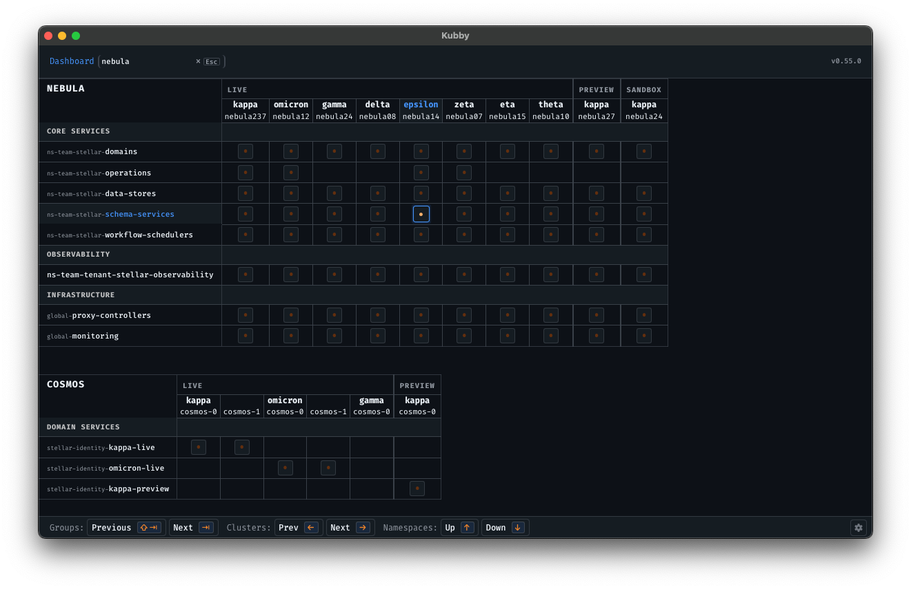

## Resources

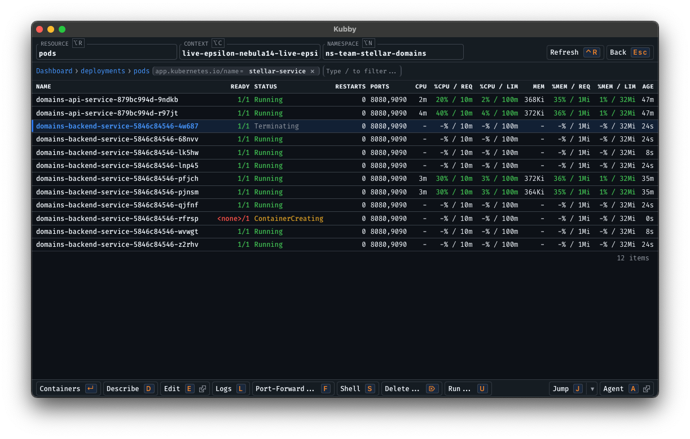

## Describe

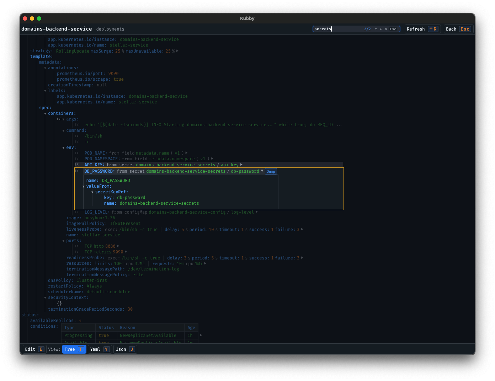

## Jump to Related Resources

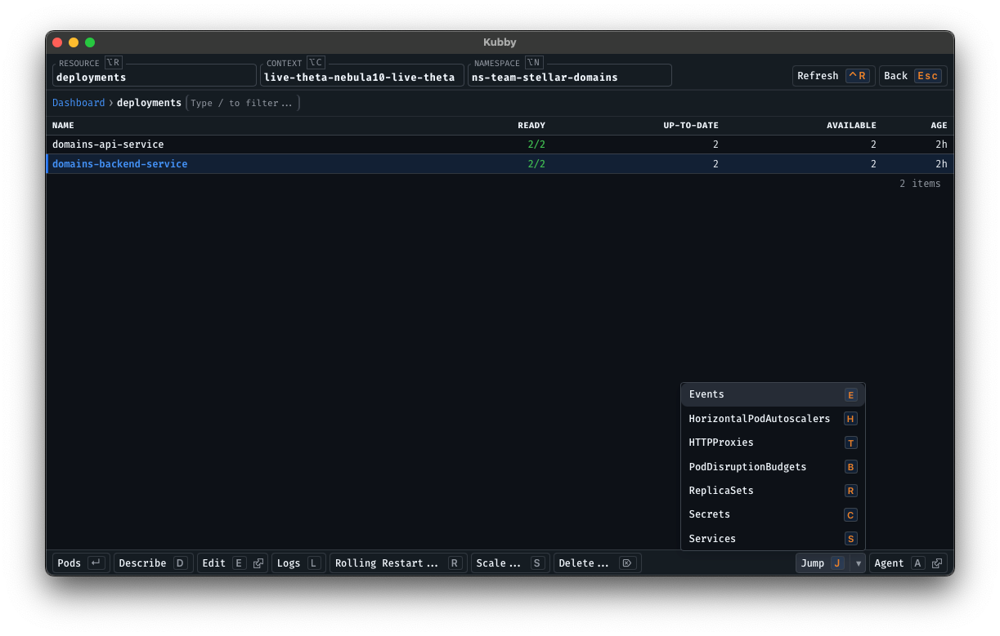

## Decode Secrets

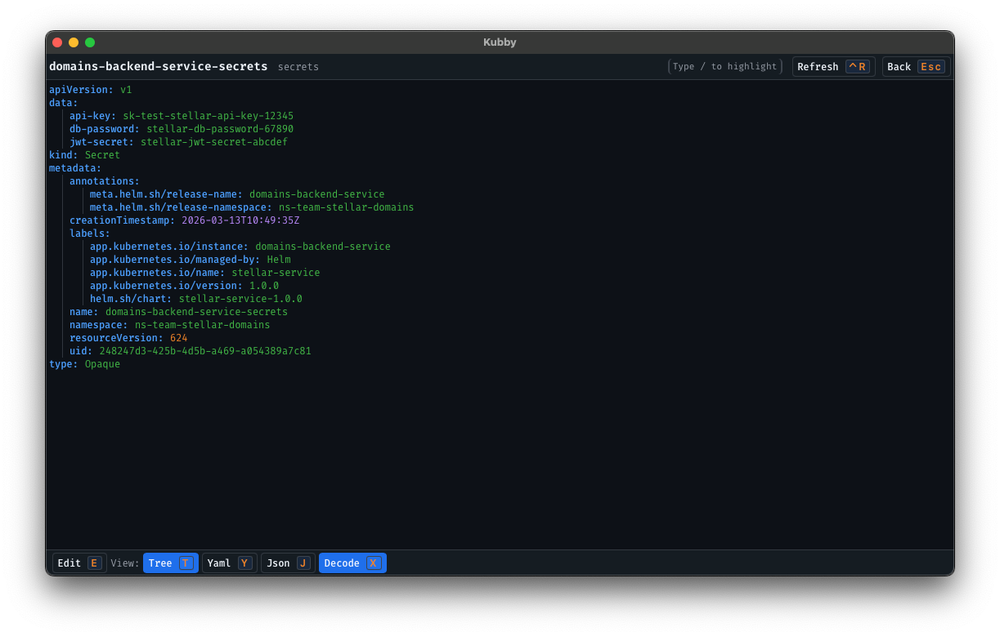

## Change Context

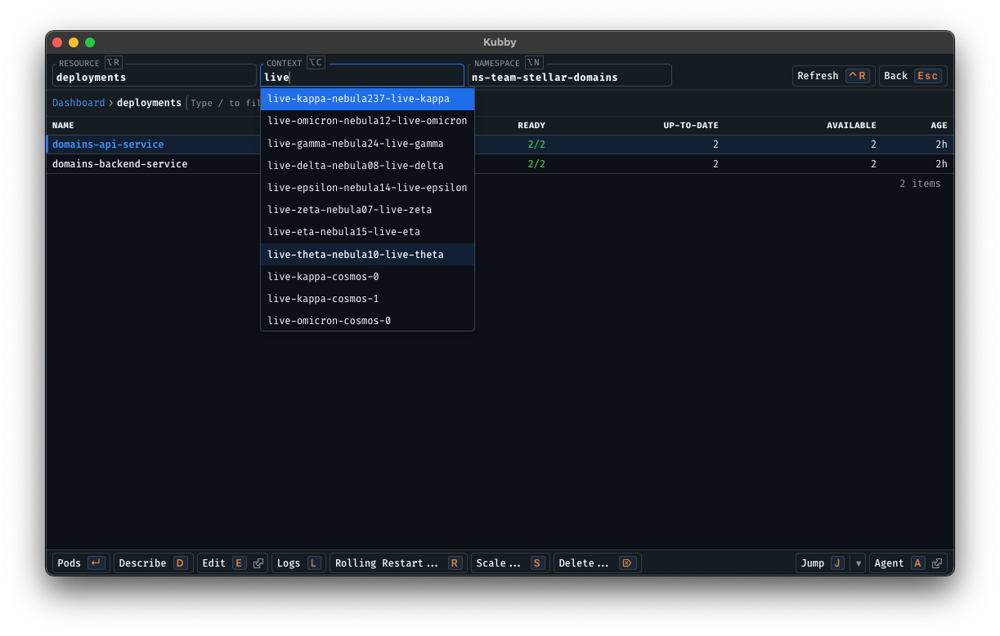

## Port Forward

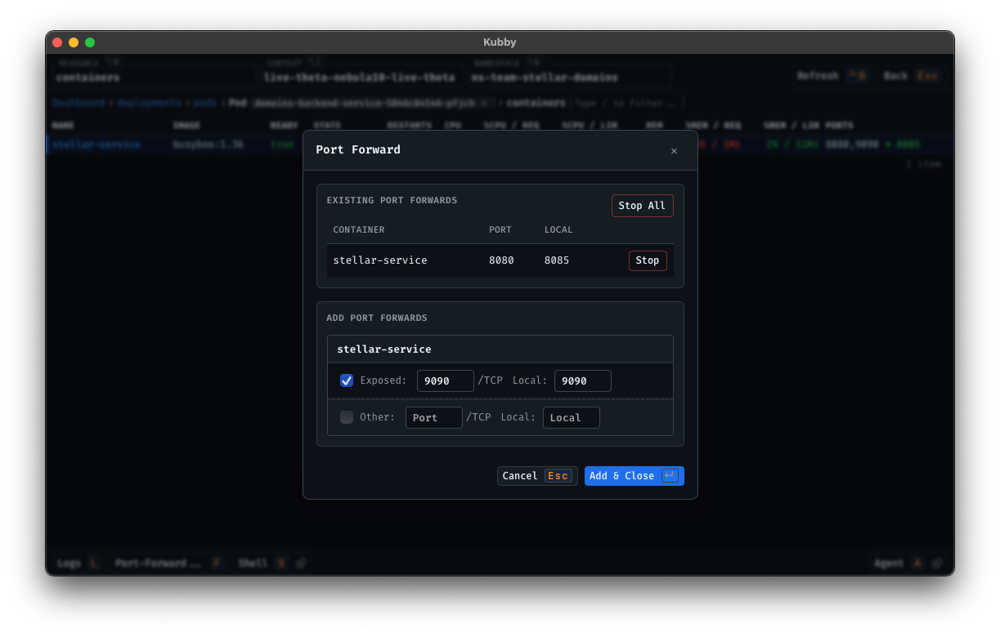

## Rolling Restart

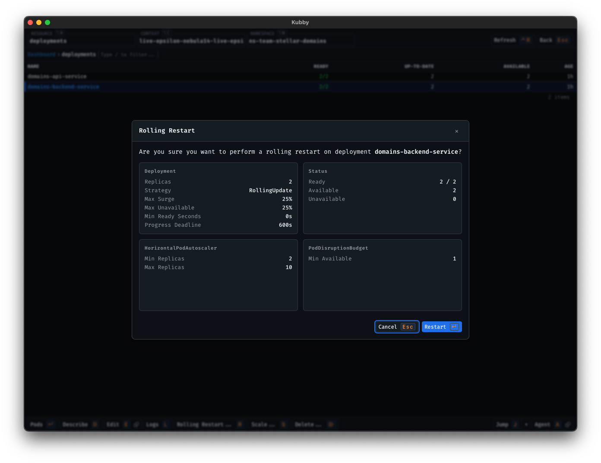

## Scale

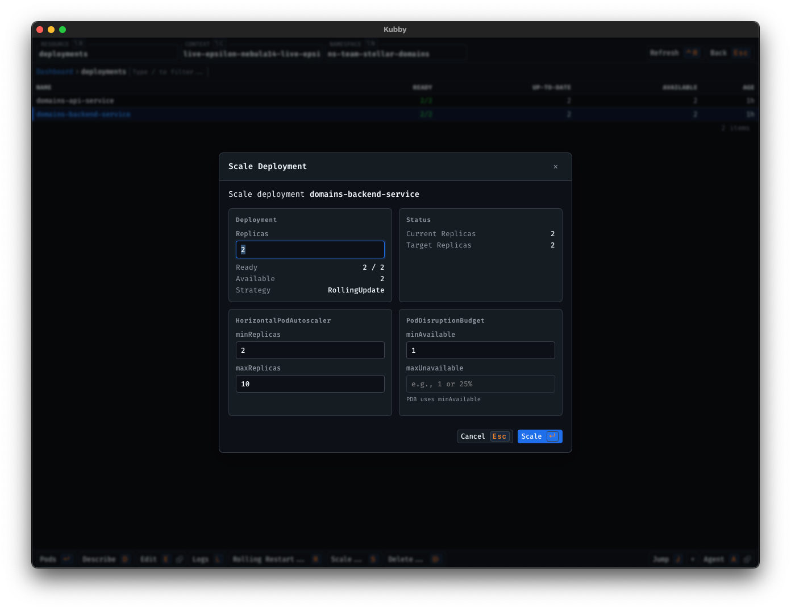

## Shell

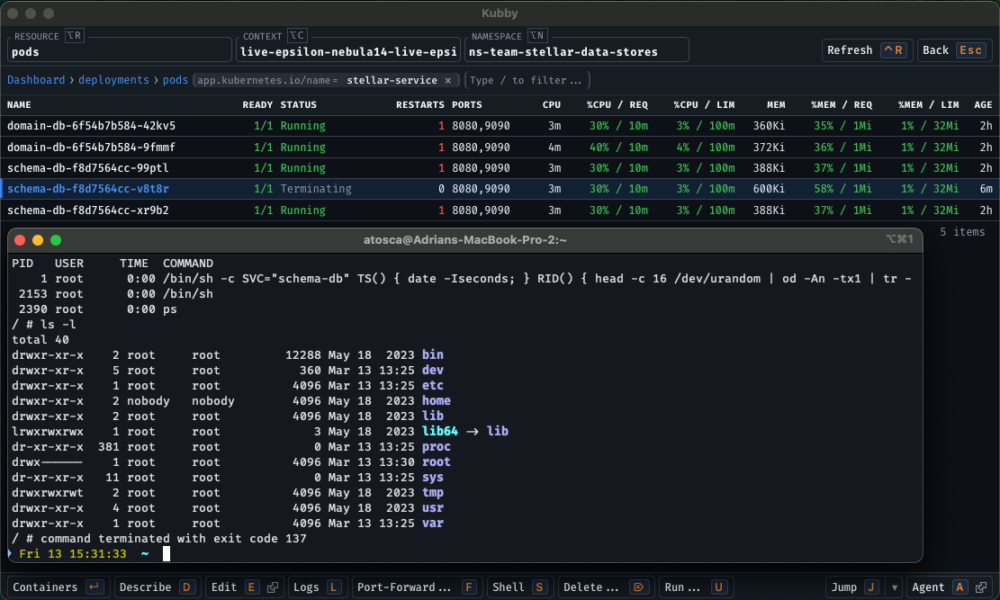

## Run Command

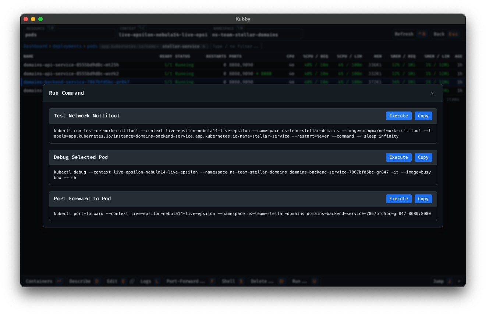

## Agent

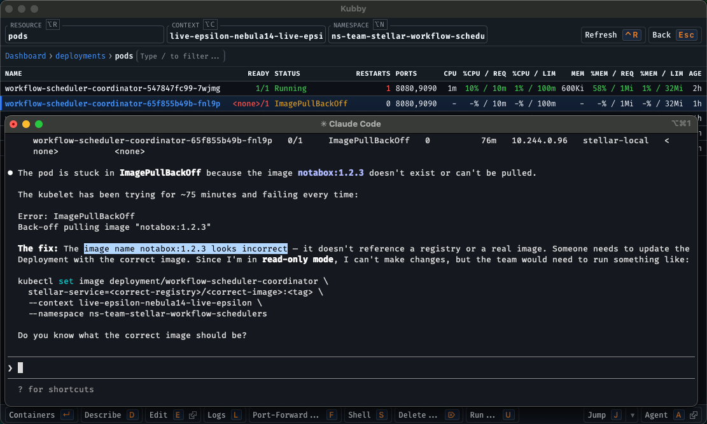
